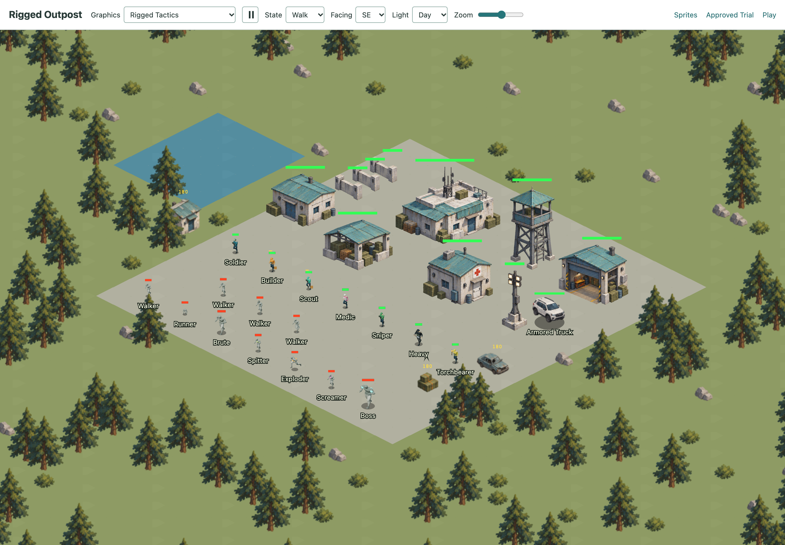
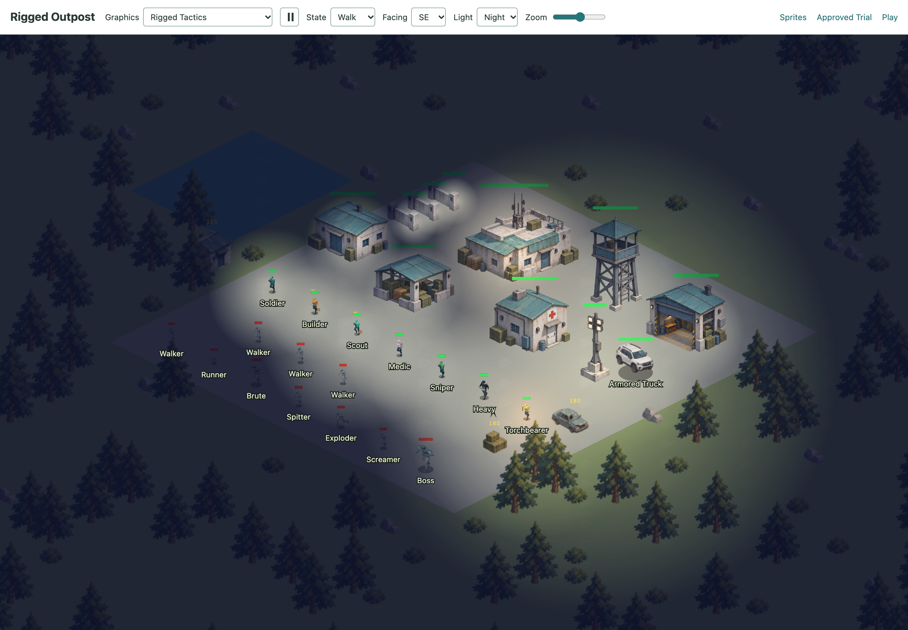
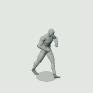
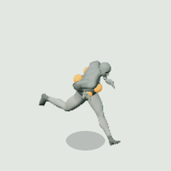

# Dead Zone RTS

**[Play Dead Zone RTS](https://asaeed.github.io/zombie/)**

Browser zombie-survival RTS. Vanilla JS + Canvas 2D, no build step or runtime
dependencies. Scavenge supplies, build an outpost, and survive escalating waves
of zombies through day and night.

## Screenshots

Day and night views of the Rigged Tactics outpost.

| Day | Night |
| --- | --- |
|  |  |

## Animation previews

Walking, running, and directional sprite previews.

| Soldier walking | Builder walking |
| --- | --- |
|  |  |

| Walker | Running exploder |
| --- | --- |
|  |  |

**Armored truck: eight-view turnaround**


## Controls

- Left click / drag: select units · selected unit + cache click: auto-gather
- Right click: move / attack / gather / dump cargo / repair
- Build: `W`all, `T`ower, `B`arracks, `D`epot, `L`ight tower, clinic (`K`), mechanics bay (`M`) · one placement per selection · Esc: cancel · Del: sell
- `A` + click: attack-move · `S`: stop · `R`: builder repair · `H`: select idle units
- `1–9`: control groups (`Shift+digit` assigns, double-tap centers)
- Barracks: click for training (`Z`/`X`/`C`/`V`/`Q`/`E`/`Y`) · right-click sets rally point
- Mechanics bay: select and press `U` or use its production button to build an armored truck
- Armored truck: select and right-click ground to drive; right-click it with units selected to board (four seats); `E` or Unload to disembark
- `F` + click: throw a signal flare (50 supplies, 60s cooldown) — lights terrain, wakes sleepers, and ignites nearby zombies without distracting them; burning zombies move 20% faster
- Camera: wheel zoom · middle-drag / arrows / minimap click: pan
- Click a screen edge to arm auto-scroll; moving off the edge stops it
- `Space`: jump to HQ · `F1–F4`: bookmarks (`Shift+F` sets) · `N`: latest alert
- Menu: top-right `MENU` button for pause, save/load slots, and restart

## Gameplay

- Supplies come from scavenging: search the wrecked cars, cabins and bins
  scattered across the map (walk a unit onto one; contents are unknown until
  searched), then haul the loot back to the HQ or a depot to bank it. A selected
  unit ordered onto a cache will fill from nearby caches when it runs dry,
  then keep shuttling until that area is exhausted.
  Loading and unloading takes time; cargo makes units move and fire more slowly
- Right-click a dropped supply bundle to recover every dropped bundle in that
  area until the unit is full, then it will return to unload
- Farther caches are richer — and more likely to be guarded by dormant
  zombies that wake on proximity or gunfire. Units drop their cargo when
  they die; the bundle stays where it fell until someone recovers it
- Fog of war: the map starts dark. Scout to find caches; explored ground
  stays on the map, but zombies are only visible where you have vision
- The HQ stores 500 supplies, each depot adds 250 more, and banking stops when
  storage is full. Right-click the HQ or a depot with a carrying unit selected
  to send it home to dump cargo. A destroyed depot loses only its equal share
  of supplies above the HQ's capacity, divided among depots before the loss.
  Losses round down to whole supplies; the remainder stays in surviving depots
- Kills score points but pay nothing; each cleared wave pays a small bonus
  (always banked, even over cap); repairs cost supplies
- Night falls every 3 minutes (2 minutes long): vision shrinks to flashlight
  range and your defenders can only shoot zombies that are LIT. Light towers
  (60 supplies, no weapon) push the lit perimeter outward — keep the camp lit
  or your towers go silent right when the horde arrives
- Flares are temporary fire sources: nearby zombies catch fire, take damage
  over time, become moving light sources, and can ignite zombies in near contact
- A clinic unlocks medic training at the barracks. Medics automatically move
  to heal wounded units nearby, then return to their previous station
- A mechanics bay unlocks snipers, heavies, and torchbearers at the barracks.
  Snipers prioritize special zombies at long range; heavies cleave several
  zombies with each melee swing; torchbearers ignite enemies at short range
  and provide mobile light at night
- The mechanics bay builds four-seat armored trucks. Armed passengers fire from
  the vehicle while its hull takes incoming damage; if destroyed, they exit
  unharmed. Heavies cannot swing and medics cannot heal while aboard
- Intact buildings and walls block zombie movement, including diagonal gaps
  where two wall corners meet
- Builders automatically move to and repair damaged buildings nearby, at one
  repair tick per second, then return to their station. Range includes building
  footprints, and builders respond to new nearby damage during the return trip
- Waves keep escalating until the HQ falls
- Wave 4 brings spitters that lob acid over walls; wave 6 adds exploders
  whose shot-down blast is wider and loses damage with distance; wave 8 adds screamers that speed nearby zombies
  and shriek to wake dormant guards only when a human unit comes close.
  The first boss brute arrives on wave 10, then two on wave 15, three on
  wave 20, and so on. Bosses hit hard and resist tower fire. Zombie HP
  stays fixed by type; later waves add more enemies instead
- Each wave attacks from a marked map edge (two edges from wave 6 onward).
  The HUD and minimap warn you 20 seconds before the wave begins
- The game autosaves to this browser every few seconds and restores on refresh.
  The menu also has three local save slots for manual save points

## Architecture

- Simulation runs on an 80×80 tile grid in world coordinates:
  [game state](js/game.js), [entities](js/entities.js), and
  [pathfinding](js/pathfinding.js).
- Rendering uses Canvas 2D with a 2:1 isometric projection. Coordinate conversion
  lives in `worldToScreen` and `screenToWorld` in [js/utils.js](js/utils.js).
- The Rigged Tactics artwork includes seven player roles, seven zombie types,
  three additional walker appearances, eight building types, an armored truck,
  supply caches, and forest scenery. Sprite sheets contain directional animation
  clips; buildings, scenery, and terrain have day/night variants. The
  [art manifest](assets/rigged-full/manifest.json) defines frames and anchors.
- The [renderer](js/renderer.js) caches terrain and scenery while panning and
  uses a 24 MiB LRU cache for scaled sprite frames. The simulation uses a spatial
  grid for nearby zombie queries.

## Development

Serve the repository over HTTP:

```sh
python3 -m http.server 8787
```

Open [localhost:8787](http://localhost:8787/). Saves are stored in the browser's
local storage.

Run the tests with Node.js:

```sh
node --test tests/*.test.mjs
```
