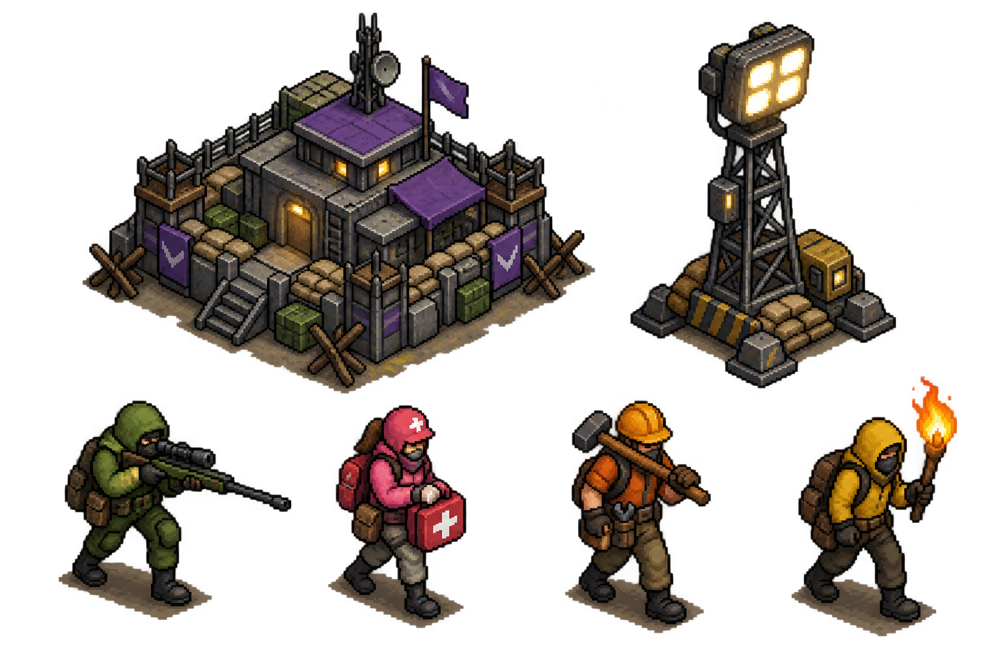
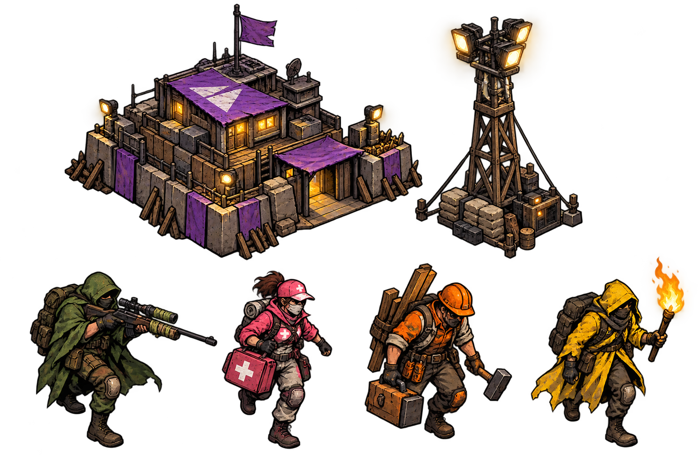
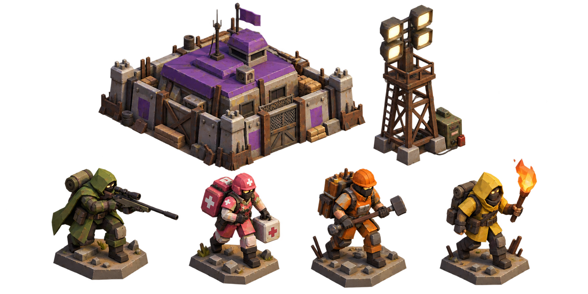

# Dead Zone visual direction studies

## Current production pass

The approved filtered Brushwork walk method now has a complete optional
[layered outpost](brushwork-full-world.html),
[sprite inspector](brushwork-full-sprites.html), and
[playable skin](../../?artPack=brushwork-layered). It covers the entire roster
with generated complete body/limb components, 16-frame walks and role-specific
combat/work clips. Matching painted Brushwork architecture, quiet terrain,
scenery, supply caches and vehicle are retained. Five painted facings plus
three mirrors are explicit in the manifest. The earlier skins and game saves
remain intact; full-roster appearance/action review is still open.
Production recipe, source provenance and verification are documented in
[`docs/art-packs.md`](../art-packs.md).

The [Sculpted World review](sculpted-world.html) assembles the current roster,
structures, terrain and vehicle beside one another. Day/night, action,
facing, zoom and camera drag are available. The
[sprite inspector](sculpted-pixel-sprites.html) exposes every character's
individual frames at enlarged and actual game sizes.

The user accepted the smaller sniper/walker sets as good enough for now and
asked to expand the selected Sculpted Pixel concept. The default game now
uses this direction; [`?artPilot=off`](../../?artPilot=off) preserves the
earlier rendering. This pass covers all seven player roles and seven zombie
types, plus three grey walker appearances, eight buildings, three resource
caches, a white SUV, grass/dirt/water textures and pine/bush/rock props.
The new artwork is a first production pass, pending user feedback.

Character appearance comes from the built-in image-generation tool with the
actual approved concept and directional references. No separately billed
API was used, and the tool did not disclose a model name. Directional raster
masters feed the articulated 2D texture rig; these are not independently
painted animation frames. Hands-free rifle/pistol gathering masters and
targeted north-facing corrections are retained. Runner arm/leg joints and
fast cadence differ from the slower heavy/brute movement. Specials keep
fixed neon identifiers. Ordinary walker clothes remain grey.

Expanded character cells are normally 96x96, anchor 48,87, with per-role
display scales. The boss has 120x96 cells, anchor 60,87, to contain its wide
swing without changing its displayed size. The accepted sniper/walker
128x128 atlases and 0.56 display scale are unchanged. Static art has measured
alpha bounds and ground anchors. Building/cache hit tests and unit
occlusion use the displayed artwork; actors keep their simulation footprints.
Terrain uses 16 square samples per material; props are deterministic cosmetic
scatter and avoid structures/caches, without changing pathfinding or saves.
The current ground uses broad, low-contrast generated material patches instead
of the first pass's dense speckling. Its source is
`assets/sculpted-pixel/source/world/quiet-terrain.png`; the earlier textures
remain available as source references.
Material-matched underlays remove the dark tile-edge seams. Current terrain
checks are recorded in `assets/sculpted-pixel/world/terrain-validation.json`,
with [day](quiet-ground-day.png), [night](quiet-ground-night.png) and
[native-zoom](quiet-ground-native.png) captures.

- Assets: `assets/sculpted-pixel/world/manifest.json` and adjacent PNG/JSON.
- Sources/prompts: `assets/sculpted-pixel/source/world/generation.json` and
  original masters in `assets/sculpted-pixel/source/`.
- Bake: `node tools/sculpted-pixel/bake-world.mjs`.
- Terrain only: `node tools/sculpted-pixel/bake-world.mjs --terrain-only`
  preserves all character and object atlases.
- Verify: `node tools/sculpted-pixel/verify-world.mjs` and
  `node --test tests/*.test.mjs`.
- Evidence: `assets/sculpted-pixel/world/validation.json`; day/night and
  crowded-game screenshots under `docs/art-directions/`.

Known refinement areas: texture mesh deformation can stretch large reaches;
the dress walker master also has one missing arm; runner currently has one
appearance. Two corrected vehicle diagonals mirror their opposite masters,
including baked shading. Existing game HUD overlap at mobile width is a
separate pre-existing issue; both new review pages fit the tested widths.

## Earlier Two-Character Pass

The [Sculpted Pixel sprite sets](sculpted-pixel-sprites.html) are the latest
sniper/walker production test, using reference-generated raster artwork and
an articulated 2D texture rig. The user accepted this richer shaded appearance
after the procedural alternatives. Each set has eight facings; sniper has
idle/walk/shoot/gather, walker has idle/walk/attack. The game-scale opt-in is
[`?artPilot=sculpted`](../../?artPilot=sculpted). Sources, exact generation
prompts, rig code, atlas metadata, and validation are retained with
`assets/sculpted-pixel/` and `tools/sculpted-pixel/`. Rebuild with
`node tools/sculpted-pixel/bake.mjs` while the local server is running.

The earlier concept studies below are historical direction context. The
two-character appearance and smaller game scale were accepted as good enough.
The sniper and walker now render at 0.56 scale, about 43 body pixels at zoom 1
and 15% smaller than the initial test. Feet stay at the same world anchor;
collision, selection, and other pilot styles are unchanged.
Validation: `node --test tests/diorama-art.test.mjs tests/sculpted-pixel.test.mjs`
and `node tools/sculpted-pixel/verify.mjs`. The latter uses isolated browser
storage, audits every occupied atlas cell, and exercises movement, gathering,
shooting, and melee attacks. Results are retained in
`assets/sculpted-pixel/validation.json`. Walks have twelve distinct frames
per facing; idle breathing and action return poses have intentional repeats.
The frames use a textured 2D rig, not individually painted action poses.

The [focused pixel and diorama review](pixel-diorama-directions.html) is the
previous concept comparison. The original voxel diorama, with only the walker,
runner, and spitter heads adjusted away from perfect cubes, was the earlier
selected visual direction.
The untouched original, brighter D, broader diorama revisions, and three
related variants remain available for comparison. The earlier
[whole-game direction review](whole-game-directions.html) applies brighter D,
the earlier zombie-study A/B/C styles, and two other styles to the same HQ,
light tower, sniper, walker, runner,
spitter, and brute. Each board includes idle, movement, and attack key poses
for the unit and four zombie types. These are AI-generated concepts, not
seamless sprite sheets, measured source-pixel examples, or game assets.
This selection fixes the visual target, not the production sprite resolution,
rig, camera, atlas, or animation timing.

The focused variants use the same whole-game brief below. Their additional
image-generation style clauses were:

- **Voxel zombie heads:** preserve the original scene and poses, changing only
  the smaller zombies' skull silhouettes with sloped crowns, angled cheeks,
  and tapered jaws; retain the modular body and world construction.
- **Rounded diorama:** preserve the voxel scene and poses, but replace square
  humanoid heads and block-jointed limbs with rounded, expressive anatomy;
  keep modular architecture and terrain.
- **Faceted diorama:** a restrained revision of the rounded board with firmer
  planar heads, shoulders, hands, and boots, while retaining humanlike faces.
- **Bold pixel:** genuinely lower-detail pixels, larger clusters, flatter
  color ramps, and less tiny environmental or costume detail.
- **Sculpted pixel:** blend D's crisp pixel finish with the revised diorama's
  rounded low-poly anatomy and broad light planes.
- **Painted tabletop:** physical, hand-painted miniature forms and scenery,
  with no visible voxel cubes; display bases are concept-board staging only.

The original three phase-7 boards further down this page are also **concept
boards**, not production sprites or animation sheets. They compared HQ, light
tower, sniper, medic, builder, and torchbearer. Their transparent PNGs are
deliberately not wired into the game yet.

The game currently uses vanilla JavaScript and one Canvas 2D renderer. Its
simulation is an 80x80 grid, projected to 2:1 isometric diamonds (64x32 screen
pixels per tile at zoom 1). Procedural shapes are depth-sorted by world X + Y;
fog, lighting, selection, and HUD are composited in the same renderer. The
[existing spec](../superpowers/specs/2026-07-13-overhaul-design.md) chose true
isometric pixel art, so changing that should be an explicit art decision.

**Previous target:** option D's brighter 24x32 logical unit grid. The new
voxel-diorama selection supersedes that look; the source-pixel budget must be
measured in a game-scale pilot. The "Breach" mark remains the game favicon.
The [native-grid sprite study](native-sprite-options.html)
compares five original designs at 12x16, 16x20, 20x26, 24x32, and 32x40 source
pixels per unit. The first two retain the favored lower-resolution designs;
the remaining three explore higher detail while keeping the same on-screen
footprint. The earlier [downsampling study](resolution-lab.html) did not
adequately change the art for each pixel budget and has been superseded.

The [sprite-sheet pilot](sprite-sheet-pilot.html) proves a separate-frame
workflow at 12x16 logical pixels: 8 headings; 1 idle, 6 walk, 4 shoot, and 4
gather poses per heading. It generates a transparent atlas and JSON frame
metadata with a fixed foot anchor. The walk, recoil, and reaching poses are
different drawings. This is code-authored proof of mechanics, not final unit
art or a fully rigged 3D render. It predates the 24x32 selection and does not
set the production asset resolution.

The [zombie cast](zombie-lineup.html) uses cached in-game Canvas atlases at
option D's visual scale. Walkers and runners are grey with lighter grey pants;
eight stable combinations of missing arms, caps, and dresses replace colored
clothing. Spitter, exploder, screamer, brute, and boss each keep a fixed look
with a luminous identifying feature. All have directional idle, move, and
attack frames. Runners use a low four-point sprint and faster movement;
brutes animate at a slower, planted cadence. This is code-authored game art,
not a rigged 3D render.

The [zombie redesign study](zombie-directions.html) compares three new
appearance and motion directions: faceted miniatures, classic RTS pixel
realism, and graphic horror. Its AI-generated boards are pose concepts only,
not matching directional frames. The production brief remains grey ordinary
zombies with lighter grey pants and trait-based variation, even where a
concept image misses a small wardrobe detail.

## Whole-game board prompts

Each board used the same image-generation brief: a landscape isometric RTS
encounter with a purple-roof HQ, yellow-lit light tower, green sniper, grey
walker, small low runner, lime-throated spitter, and cyan-marked brute. Under
the scene, five rows show three distinct full-body key poses per character:
idle, locomotion, and action (fire, reach, lunge, spit, or swing). The prompts
required structures, terrain, humans, and zombies to share one camera, scale,
lighting, and rendering style, without text or UI. Style clauses were:

- **D:** bright, intentional pixel clusters and hard-edged facets, with a
  24x32 logical unit target to be validated later rather than inferred from
  the generated board.
- **A:** grounded low-poly miniature facets and muted battlefield lighting,
  using the earlier faceted zombie concept as a style reference.
- **B:** late-1990s RTS pixel realism, controlled dithering and military color
  ramps, using the earlier RTS zombie concept as a style reference.
- **C:** charcoal and bone-grey angular graphic-horror silhouettes, using the
  earlier silhouette zombie concept as a style reference.
- **E:** bright tactical cel animation with clean contours and broad flat
  shadow shapes.
- **F:** hand-painted chunky voxel diorama with cubic anatomy and modular
  structures.

These are prompts for comparison images, not specifications for a renderer or
proof that the pictured poses can be interpolated into animation.

## Animation production

- At 12x16, use a rigged low-poly model to block consistent anatomy and
  motion, then redraw reduced frames where pixels merge awkwardly.
- At 16x20 or 20x26, more of the broad 3D light/shadow planes can survive the
  reduction. Preserve role props and negative space between limbs.
- At 24x32 or 32x40, extra armor and kit detail become possible, but may be
  invisible at normal game zoom. Judge these in a crowded nighttime scene
  before committing to the larger atlas and cleanup cost.
- Lock the orthographic camera, model pivot, foot anchor, light rig, and frame
  bounds. Render transparent image sequences for each direction and action;
  pack only after checking loops and transitions in the game at its normal
  zoom and night lighting. Blender supports [orthographic cameras](https://docs.blender.org/manual/en/latest/render/cameras.html)
  and [transparent film](https://docs.blender.org/manual/en/latest/render/cycles/render_settings/film.html).
- The image-generation model is useful for concept and color exploration, but
  independent AI images cannot guarantee matching anatomy, anchors, timing,
  or seamless animation frames. Do not treat generated contact sheets as a
  production sprite atlas.

## A. Chunky pixel art

- **Look:** controlled 20-30-color palette, strong dark outlines, hard pixels,
  distinctive role colors, warm practical lights against a cool night map.
- **Runtime:** transparent PNG frames or a packed atlas drawn in Canvas 2D with
  `imageSmoothingEnabled = false`. Keep existing projection, lighting, and UI.
- **Production cost:** every animation pose and direction needs deliberate
  pixel cleanup. Generated concept art is a starting reference, not a reliable
  frame sequence or a correctly sized sprite sheet.
- **Fit:** closest to the older spec and lowest renderer risk, but not the
  direction selected for production.

## B. Inked graphic novel

- **Look:** heavy silhouettes, angular ink, limited cel shading, distressed
  painted surfaces, vivid role colors.
- **Runtime:** the same Canvas 2D image pipeline, with smoothing enabled for
  scale changes. No 3D engine required.
- **Production cost:** hand-painted poses are expensive to keep consistent;
  fine lines and texture collapse at the current unit size, especially at
  minimum zoom and at night. Needs a much simpler in-game reduction than this
  concept board.
- **Fit:** strongest editorial personality, weakest small-scale clarity.

## C. Pre-rendered low-poly 3D

- **Look:** weathered tactical miniatures with orthographic camera, blocky
  geometry, flat facets, and colored equipment. Production sprites should
  omit the large display bases shown in this concept.
- **Runtime:** model and animate offline, render transparent directional PNG
  frames, then use the **same Canvas 2D atlas path** as A and B. This is not a
  live 3D game.
- **Production cost:** adds a 3D source-asset/render pipeline, but consistent
  viewpoints and walk/attack frames become easier to reproduce once rigs and
  lighting are fixed. Pre-baked highlights will not follow runtime light
  direction; existing light pools and tinting can still work over the sprites.
- **Fit:** the offline 3D source and Canvas 2D sprite pipeline is now proven by
  the opt-in sniper/walker game-scale pilot below. The remaining roster and
  structures still need their own art and integration pass.

## Runtime decision

**Use Canvas 2D sprites for this polish phase.** Canvas `drawImage` accepts
source rectangles from an atlas, so a sheet is convenient later, but separate
transparent PNG frames are fine for a first pilot. A live Three.js scene would
need a new renderer, orthographic camera, world/depth mapping, light and fog
system, selection hit tests, and integration with the existing HUD. It would
not require rewriting the square-grid simulation, but it is a separate engine
migration rather than an art swap. [Canvas image drawing](https://developer.mozilla.org/en-US/docs/Web/API/CanvasRenderingContext2D/drawImage),
[pixel-art scaling](https://developer.mozilla.org/en-US/docs/Web/API/CanvasRenderingContext2D/imageSmoothingEnabled),
and [Three.js orthographic cameras](https://threejs.org/docs/pages/OrthographicCamera.html)
are the relevant runtime primitives.

For production, define per-sprite metadata (frame rectangle, foot anchor,
footprint, direction, animation timing). Keep the current procedural shape as
a fallback until each entity is approved. Author source art against actual
game dimensions: units roughly 20-30 screen pixels wide and 28-40 tall at
zoom 1; an HQ spans a 3x3 tile footprint while a light tower spans 1x1. Test
at zoom 0.5, 1, and 2, during day and full night, before scaling up the set.

## Selected-direction pilot

The [animated comparison](../../tools/diorama/bake.html) shows the sniper and
one regular walker appearance in three separately authored treatments:
[`?artPilot=diorama`](../../index.html?artPilot=diorama),
[`?artPilot=pixel`](../../index.html?artPilot=pixel), and
[`?artPilot=horror`](../../index.html?artPilot=horror). All other units and
zombies retain the current art. The original rendering remains the default.
The treatments share atlas dimensions, eight facings, clip names, and foot
anchors, but not source art or poses:

- Diorama (`tools/diorama/model-v2.mjs`) uses a lit, articulated Three.js rig.
- Sculpted Pixel (`tools/diorama/sculpted-pixel.mjs`) is drawn directly in a
  40x48 pixel grid with explicit color clusters, contour shading, and
  direction-specific silhouettes, using the [selected concept](focused-sculpted-pixel.png)
  as its palette and character-shape reference. It does not sample a 3D render.
- Stylized Horror (`tools/diorama/stylized-horror.mjs`) uses original 2D inked
  silhouettes, value gradients, asymmetric limbs, and separate motion poses.

The baked PNGs and frame metadata live in `assets/diorama-pilot/`. Game draw
order, selection, fog, and light overlays are unchanged.

Run `npm install` and `npm run art:bake` to regenerate the sheets and
`diorama-pilot-preview.png`. Open `tools/diorama/bake.html` through the local
web server to inspect the looping clips. All sheets use 80x96 atlas cells
rendered at 0.66 scale in the game; the pixel-native 40x48 source is doubled
without smoothing. These are character studies, not whole-world conversions
or finished matches for the concept boards.

Next production passes:

1. Choose the treatment after testing all three at normal zoom. Each still
   needs an art polish pass before full-roster production.
2. Bring one HQ, light tower, medic, and another zombie type into the chosen
   style to test whether it holds together across the whole game scene.
3. Establish a shared terrain, structure, and character palette and a night
   visibility treatment before expanding the full roster.

## Generation prompts

The built-in image-generation model was used in concept mode with transparent
backgrounds. Each board requested exactly two structures (purple-roof HQ and
light tower) and four role-colored units (green sniper, pink medic, orange
builder, yellow torchbearer), separated in a common 3/4 isometric view. The
style clauses were:

- **A:** "Meticulously hand-authored chunky pixel art, limited cohesive
  palette, hard nearest-neighbor edges, subtle dark outline, concise
  highlights, controlled game-ready contrast for a dark night map."
- **B:** "Hand-painted graphic-novel / screenprint game sprites, confident
  clean ink contours, 2-3 broad cel-shaded value planes, slightly distressed
  paint texture only within silhouettes."
- **C:** "Modeled in low-poly 3D and pre-rendered to 2D sprites; fixed
  orthographic 3/4 view, beveled block geometry, flat-shaded facets, subtle
  ambient occlusion and single warm key light, slight weathering."

All three prompts excluded labels, UI, scene backdrops, logos, and watermark.
