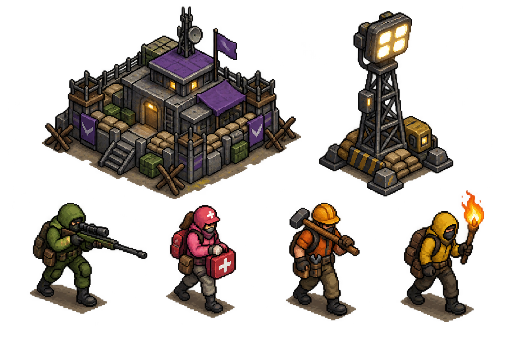
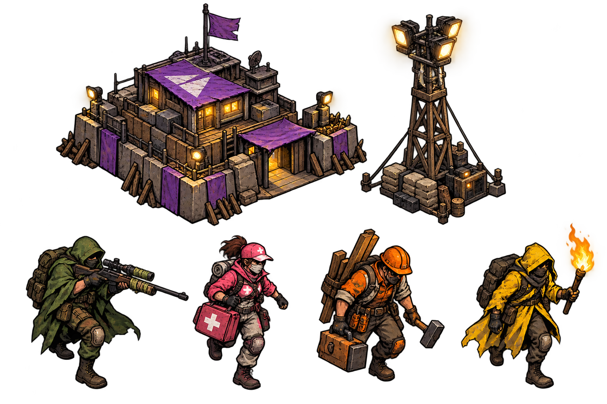
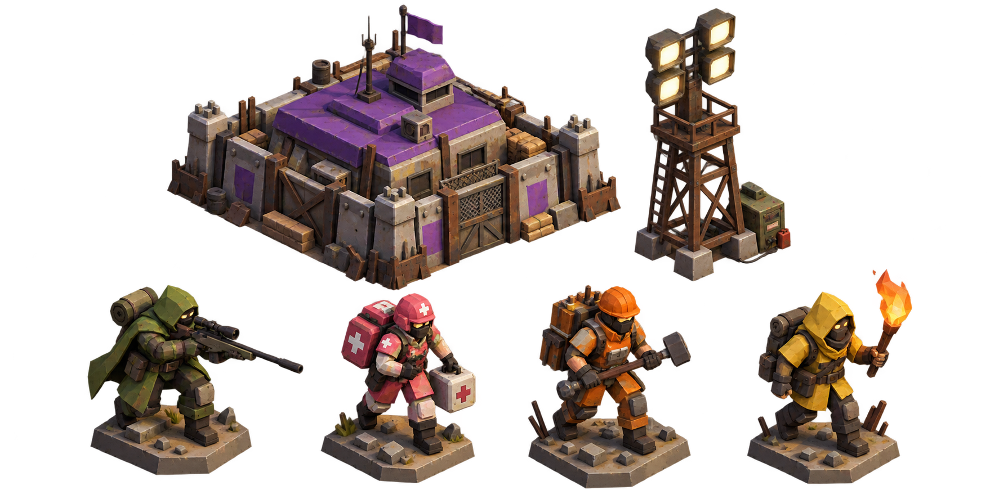

# Dead Zone visual direction studies

These are **concept boards**, not production sprites or animation sheets. They
were generated with the built-in image-generation model to compare a consistent
set of subjects: HQ, light tower, sniper, medic, builder, and torchbearer. The
transparent PNGs are deliberately not wired into the game yet.

The game currently uses vanilla JavaScript and one Canvas 2D renderer. Its
simulation is an 80x80 grid, projected to 2:1 isometric diamonds (64x32 screen
pixels per tile at zoom 1). Procedural shapes are depth-sorted by world X + Y;
fog, lighting, selection, and HUD are composited in the same renderer. The
[existing spec](../superpowers/specs/2026-07-13-overhaul-design.md) chose true
isometric pixel art, so changing that should be an explicit art decision.

## A. Chunky pixel art

- **Look:** controlled 20-30-color palette, strong dark outlines, hard pixels,
  distinctive role colors, warm practical lights against a cool night map.
- **Runtime:** transparent PNG frames or a packed atlas drawn in Canvas 2D with
  `imageSmoothingEnabled = false`. Keep existing projection, lighting, and UI.
- **Production cost:** every animation pose and direction needs deliberate
  pixel cleanup. Generated concept art is a starting reference, not a reliable
  frame sequence or a correctly sized sprite sheet.
- **Fit:** closest to the approved spec and lowest renderer risk. This is the
  recommended direction.

## B. Inked graphic novel

- **Look:** heavy silhouettes, angular ink, limited cel shading, distressed
  painted surfaces, vivid role colors.
- **Runtime:** the same Canvas 2D image pipeline, with smoothing enabled for
  scale changes. No 3D engine required.
- **Production cost:** hand-painted poses are expensive to keep consistent;
  fine lines and texture collapse at the current unit size, especially at
  minimum zoom and at night. Needs a much simpler in-game reduction than this
  concept board.
- **Fit:** strongest editorial personality, weakest small-scale clarity.

## C. Pre-rendered low-poly 3D

- **Look:** weathered tactical miniatures with orthographic camera, blocky
  geometry, flat facets, and colored equipment. Production sprites should
  omit the large display bases shown in this concept.
- **Runtime:** model and animate offline, render transparent directional PNG
  frames, then use the **same Canvas 2D atlas path** as A and B. This is not a
  live 3D game.
- **Production cost:** adds a 3D source-asset/render pipeline, but consistent
  viewpoints and walk/attack frames become easier to reproduce once rigs and
  lighting are fixed. Pre-baked highlights will not follow runtime light
  direction; existing light pools and tinting can still work over the sprites.
- **Fit:** best option if animation volume and consistency become the main
  bottleneck, with more art-tooling cost than A.

## Runtime decision

**Use Canvas 2D sprites for this polish phase.** Canvas `drawImage` accepts
source rectangles from an atlas, so a sheet is convenient later, but separate
transparent PNG frames are fine for a first pilot. A live Three.js scene would
need a new renderer, orthographic camera, world/depth mapping, light and fog
system, selection hit tests, and integration with the existing HUD. It would
not require rewriting the square-grid simulation, but it is a separate engine
migration rather than an art swap. [Canvas image drawing](https://developer.mozilla.org/en-US/docs/Web/API/CanvasRenderingContext2D/drawImage),
[pixel-art scaling](https://developer.mozilla.org/en-US/docs/Web/API/CanvasRenderingContext2D/imageSmoothingEnabled),
and [Three.js orthographic cameras](https://threejs.org/docs/pages/OrthographicCamera.html)
are the relevant runtime primitives.

For production, define per-sprite metadata (frame rectangle, foot anchor,
footprint, direction, animation timing). Keep the current procedural shape as
a fallback until each entity is approved. Author source art against actual
game dimensions: units roughly 20-30 screen pixels wide and 28-40 tall at
zoom 1; an HQ spans a 3x3 tile footprint while a light tower spans 1x1. Test
at zoom 0.5, 1, and 2, during day and full night, before scaling up the set.

## Pilot after choosing a direction

1. Finish one HQ, one light tower, one sniper, one medic, and one walker as
   transparent game-scale assets with matching foot anchors.
2. Swap only those entities to image rendering; retain shapes for everything
   else. Verify draw order, occlusion, selection, fog, and fire/light effects.
3. Add direction and animation frames only after the still assets read well
   during ordinary play. Pack an atlas when the frame set stabilizes.

## Generation prompts

The built-in image-generation model was used in concept mode with transparent
backgrounds. Each board requested exactly two structures (purple-roof HQ and
light tower) and four role-colored units (green sniper, pink medic, orange
builder, yellow torchbearer), separated in a common 3/4 isometric view. The
style clauses were:

- **A:** "Meticulously hand-authored chunky pixel art, limited cohesive
  palette, hard nearest-neighbor edges, subtle dark outline, concise
  highlights, controlled game-ready contrast for a dark night map."
- **B:** "Hand-painted graphic-novel / screenprint game sprites, confident
  clean ink contours, 2-3 broad cel-shaded value planes, slightly distressed
  paint texture only within silhouettes."
- **C:** "Modeled in low-poly 3D and pre-rendered to 2D sprites; fixed
  orthographic 3/4 view, beveled block geometry, flat-shaded facets, subtle
  ambient occlusion and single warm key light, slight weathering."

All three prompts excluded labels, UI, scene backdrops, logos, and watermark.
